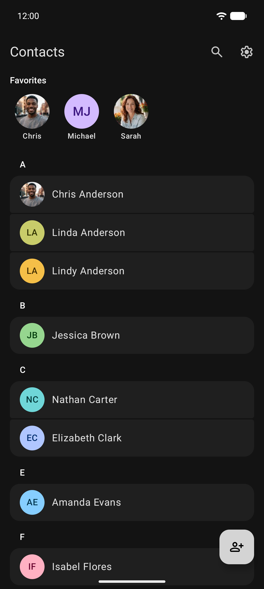
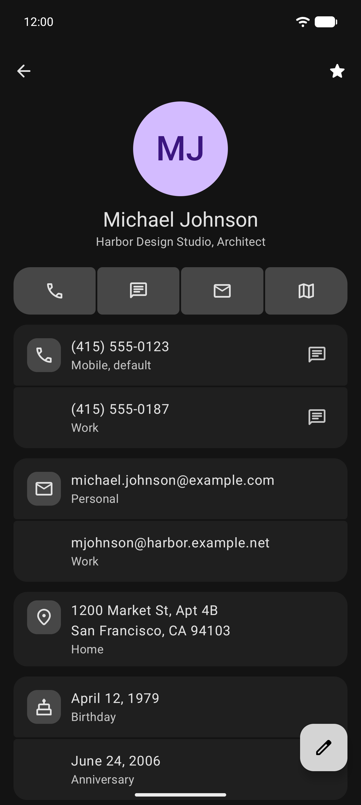
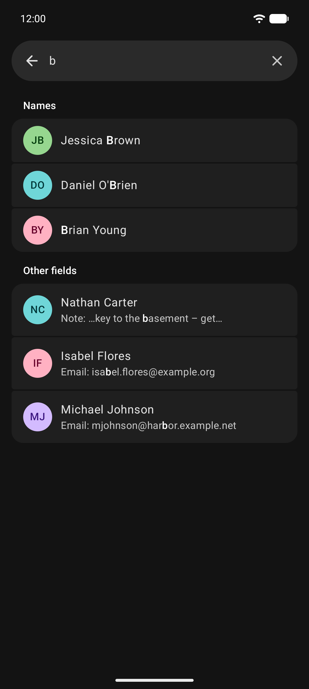
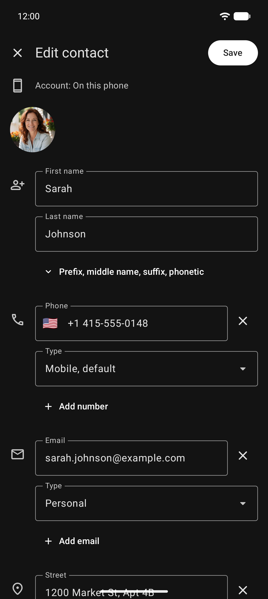
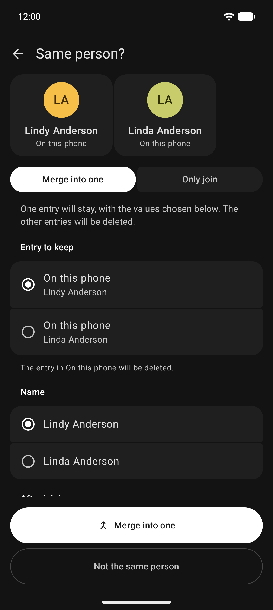
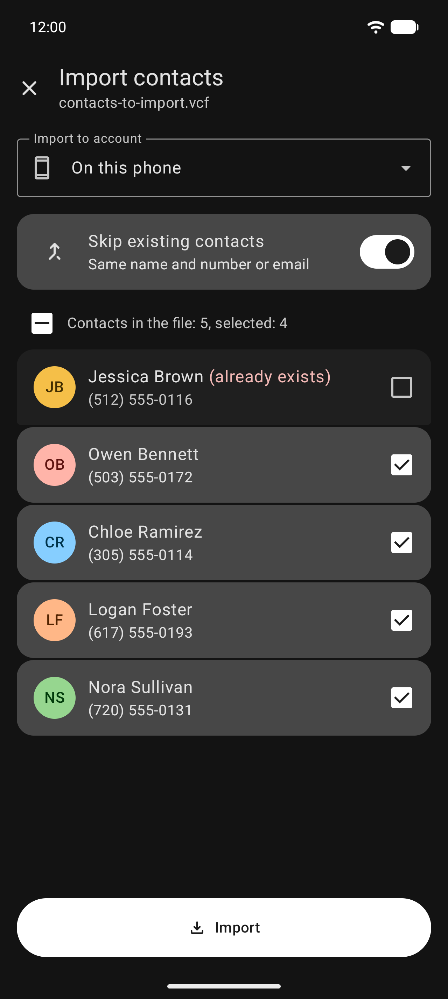

#  Contacts

A private address book for Android: the contacts already on your phone, with favorites, search in every field, merging of duplicates and vCard import and export, and no Internet access.

**Current version**: v0.1.0

Source code and releases: [git.hnet.sh/hkr/contacts](https://git.hnet.sh/hkr/contacts)

Bug reports and feature requests: [github.com/legal-hkr/contacts](https://github.com/legal-hkr/contacts/issues)

## Overview

Contacts shows and changes the contacts kept in the phone’s own contacts storage. It never connects to the Internet: syncing is left to the apps that manage your accounts, for example [DAVx⁵](https://www.davx5.com/) with Nextcloud or any other CardDAV server. No account of its own, no ads, no analytics.

## Screenshots

     

## Features

### List and search

- **Favorites**: At the top of the list, then the contacts under their letters, sorted by last name or by first name
- **Avatars**: Photos, or colored avatars with initials
- **Fast scroll**: A scroll thumb that shows the current letter
- **Search**: Names, nicknames, numbers, email addresses, companies and notes, with the match highlighted; numbers with or without the country code

### Contact page and editor

- **Quick actions**: Call, message and email in one tap, with one default number for calls and messages
- **Details**: Numbers, email addresses, addresses, websites, dates, relationships, messaging and SIP addresses, notes; touch and hold to copy
- **Editor**: Every kind of detail with your own labels, and a photo picked and cropped on the phone
- **Create contact**: From other apps, such as the phone app
- **Undo**: Deleting takes effect at once and can be undone; contacts can be shared as a vCard file

### Accounts

- **Visibility**: Show or hide each account’s contacts; messaging apps’ accounts start hidden
- **Local contacts**: Kept only on the phone; they can be moved to an account, with Undo
- **Rejected changes**: When an account’s server doesn’t accept a change or a deletion, as with a read-only address book, the app says so

### Duplicates

- **Suggestions**: By a shared number or email address, never by a name alone
- **Merge**: Merge entries permanently into one contact, choosing what stays, or only join them
- **Not the same person**: These answers are kept by the phone’s contacts storage, not by the app

### Import and export

- **vCard import**: Versions 2.1, 3.0 and 4.0, opened from another app, shared, or picked, including the character sets of older phones; contacts already on the phone are marked, and an import can be undone
- **vCard export**: All contacts, or chosen accounts, to one file, with or without photos

### Settings

- **List**: Sort order, name format, a company line, avatar colors
- **Backup and restore** of settings to a file you choose; contacts are never in it
- **Language**: English or Polish, independent of the system language

## Permissions

- **Contacts** (read and write): The contacts themselves
- No Internet permission

## Requirements

- Android 14 (API level 34) or higher

## Building

```bash
git clone https://git.hnet.sh/hkr/contacts.git
cd contacts
./gradlew assembleDebug
```

Set the Android SDK path in `local.properties` (`sdk.dir=…`) first. Unit tests run with `./gradlew test`.

## Contributing

Development happens on [git.hnet.sh](https://git.hnet.sh/hkr/contacts), where the releases are published too. The [GitHub repository](https://github.com/legal-hkr/contacts) is a read-only mirror, updated on every push, and the place to report problems:

- **Issues**: Open them on [GitHub](https://github.com/legal-hkr/contacts/issues), with the app version and your Android version
- **Pull requests**: Welcome on GitHub as well, but they can’t be merged there – accepted changes are applied on git.hnet.sh and reach the mirror from there, so the pull request itself ends up closed rather than merged

## Tech stack

- **Language**: Kotlin
- **Min SDK**: Android 14 (API 34), **target SDK**: API 37
- **UI**: Jetpack Compose with Material 3 Expressive
- **Data**: The system’s contacts provider (ContactsContract), DataStore

## License

[GPL-3.0](https://www.gnu.org/licenses/gpl-3.0.en.html)

## Acknowledgments

- [Claude](https://claude.ai) by Anthropic – AI assistant that provided valuable support during the development process, helping with code implementation, architecture decisions, and documentation
